

# Loan EMI

**A loan calculator and tracker for Android: reducing-balance EMI with a full amortization schedule, prepayment and comparison tools, a saved-loans dashboard with payment tracking, and 15 interface languages with independent currency.**

**Android** 
Flutter · Dart · Provider · Firebase · Kotlin splash and activity

<table>
  <tr>
    <td>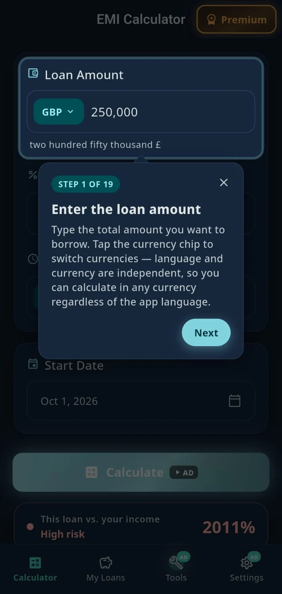</td>
    <td>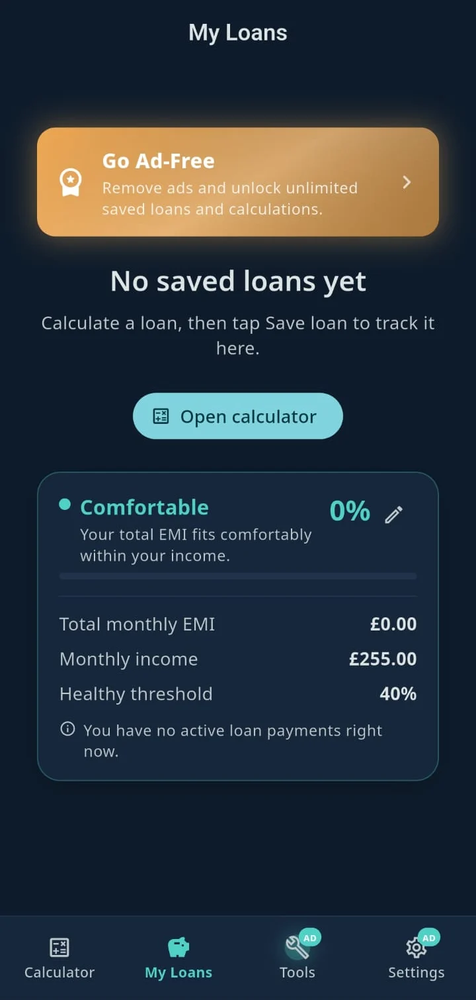</td>
  </tr>
</table>
Real screenshots from the Android app, taken on a fresh install with no saved loans.

---

## Get the App

  

<!-- fw-sale:start -->
## Reach & Availability

| | |
|---|---|
| **Product sale** | This is a Future Watch product and it is **available to buy or license** for your own business. [Ask about buying Loan EMI](https://futurewatch.co/contact?type=product&ref=loan-emi) or email [rehan@futurewatch.co](mailto:rehan@futurewatch.co). |
<!-- fw-sale:end -->

## Product at a Glance

| | |
|---|---|
| **What it is** | Loan and EMI calculator that also tracks the loans a user chooses to save |
| **Platform** | Android (Flutter) |
| **Core maths** | Reducing-balance EMI with zero-interest handling, month-by-month schedule, total interest and total repayment |
| **Planning tools** | Prepayment, loan comparison (up to four), refinance, rate stress test, APR with fees, borrowing power, affordability |
| **Other calculators** | Simple and compound interest, savings and SIP, inflation |
| **Tracking** | Saved loans dashboard with per-loan payment tracking, remaining balance and combined totals |
| **Export** | Schedule as CSV or PDF, and a text summary through the share sheet |
| **Data** | On-device first; optional Google or Apple sign-in backs data up through Firestore |
| **Monetisation** | Ad mediation for free users; a monthly or yearly subscription removes ads and the free-tier limits |
| **Languages** | 15 UI languages, including right-to-left Arabic and Urdu; 47 currencies chosen independently of language |
| **Tests** | 450 test declarations across 61 test files (counted from source) |
| **Code size** | About 29k lines of hand-written Dart, plus about 9k lines of tests |

## Product Showcase

<table>
  <tr>
    <td align="center">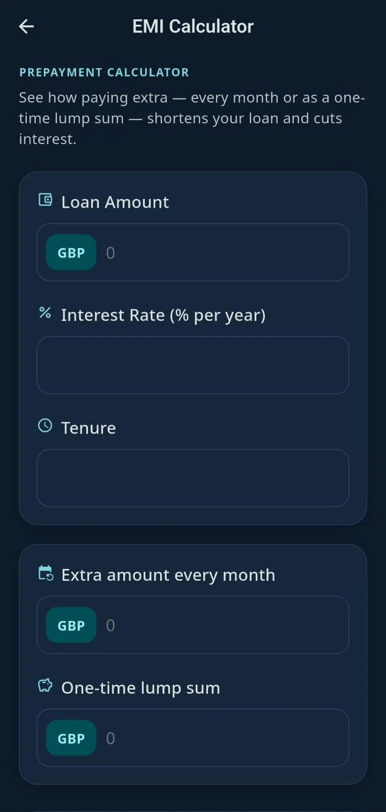 <b>Prepayment</b> Extra monthly or lump sum</td>
    <td align="center">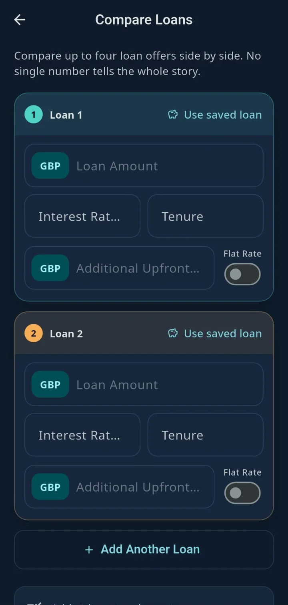 <b>Compare loans</b> Up to four offers</td>
    <td align="center">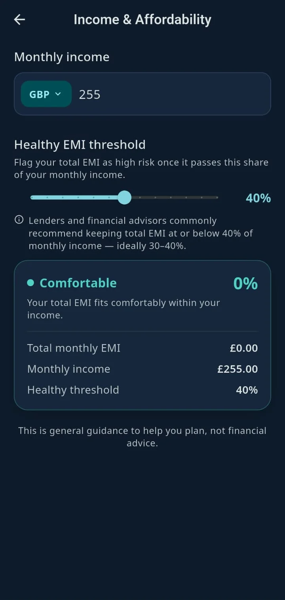 <b>Affordability</b> EMI load against income</td>
    <td align="center">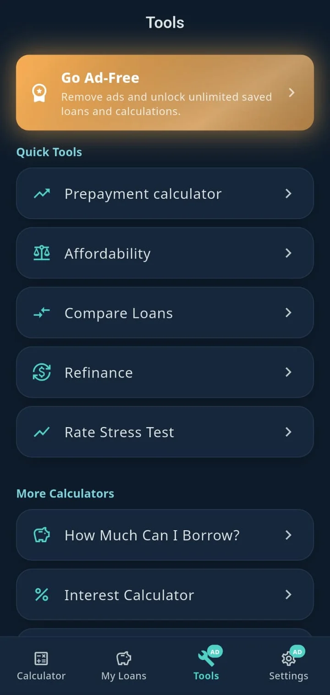 <b>Tools</b> Calculators in one hub</td>
  </tr>
  <tr>
    <td align="center">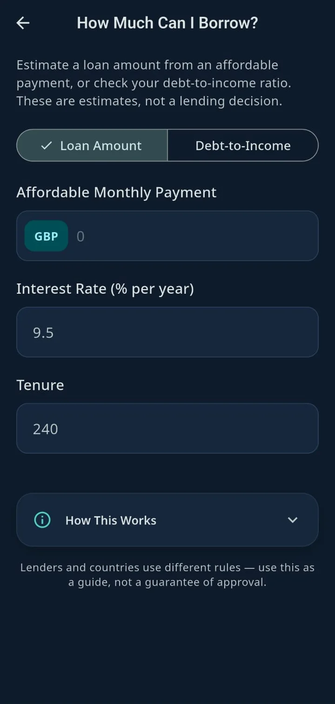 <b>Borrowing power</b> Reverse the EMI formula</td>
    <td align="center">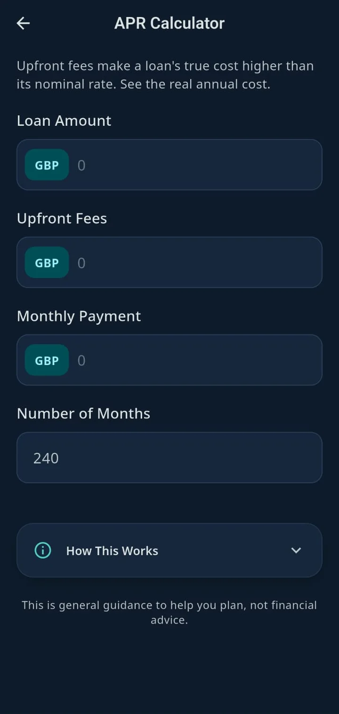 <b>APR</b> True cost with fees</td>
    <td align="center">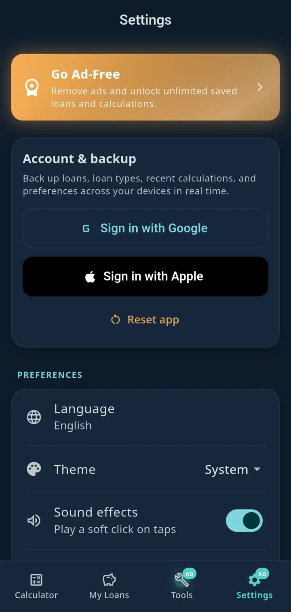 <b>Settings</b> Backup, language, theme</td>
    <td align="center">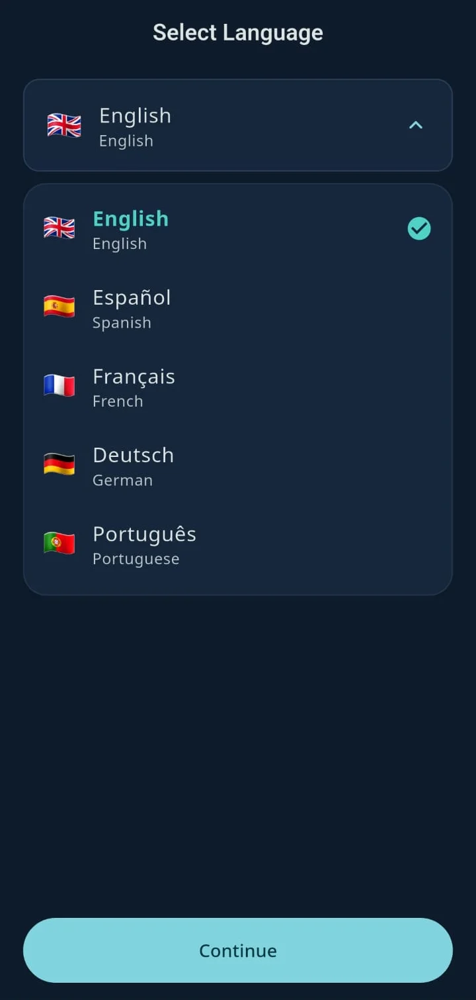 <b>Language</b> 15 languages</td>
  </tr>
  <tr>
    <td align="center">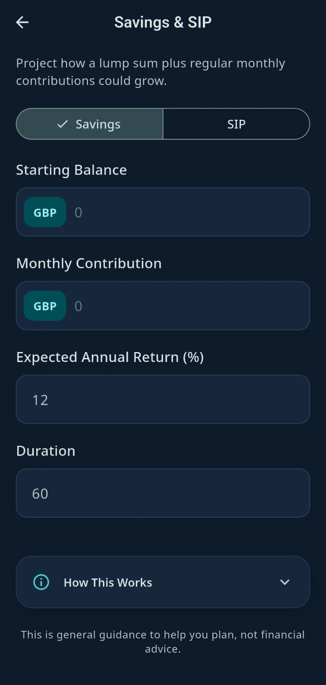 <b>Savings and SIP</b> One annuity formula</td>
    <td align="center">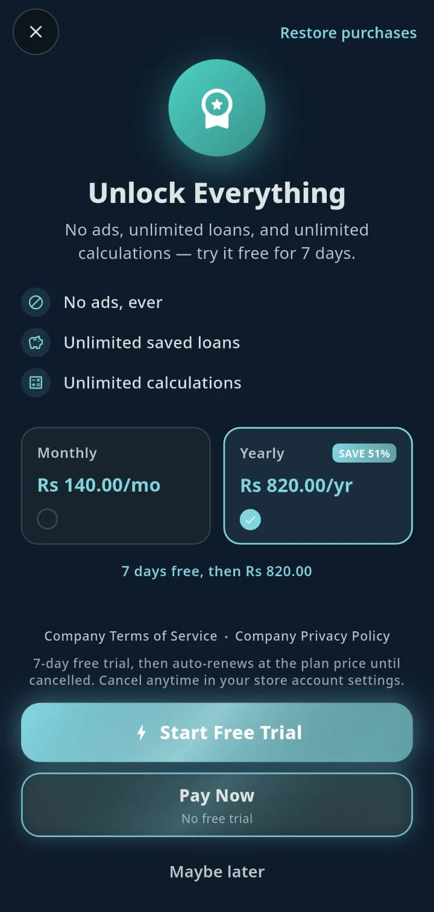 <b>Premium</b> Monthly and yearly plans</td>
  </tr>
</table>

## Key Features

- **EMI calculator.** Loan amount, annual rate and tenure (in years or months), a loan type, a start date and a currency. Results show the monthly EMI, total interest and total repayment, with a principal-versus-interest chart and a balance-over-time chart.
- **Amortization schedule.** One row per month with real calendar month labels, exportable as CSV (raw numbers for spreadsheets) or PDF.
- **Prepayment.** A recurring extra amount, a one-time lump sum at a chosen month, or both. The regular EMI stays fixed and the screen reports months saved and interest saved.
- **Loan comparison.** Two to four offers side by side, each optionally on a flat-rate basis with extra upfront costs. The app ranks each metric separately and never names a single "best" loan.
- **Refinance, stress test, APR, borrowing power.** Break-even on refinancing fees, EMI at higher rates, the effective rate once fees are included, and the loan size an affordable payment supports.
- **Saved loans dashboard.** Name a loan, then track installments marked paid, remaining balance and remaining interest. Totals are summed per currency and never across currencies.
- **Affordability.** Monthly income and an adjustable healthy-EMI threshold, compared against the combined EMI of active loans.
- **Reminders.** A local payment-due notification scheduled per saved loan.
- **Currency and language.** 47 currencies formatted by their home-region conventions, independent of the 15 UI languages.
- **Guided tour.** A 19-step coach-mark tour that can be replayed from Settings.

## Engineering Highlights

### A pure, tested calculation layer
- **Problem:** money arithmetic scattered through screens drifts and breaks on edge cases such as a zero rate.
- **Approach:** every calculator is a pure Dart function with no UI or I/O, validating input at the boundary and throwing on invalid values. Tools reuse the core EMI function instead of re-deriving it.
- **Outcome:** the maths is unit-tested in isolation, and the EMI result was cross-checked against independent calculations for this write-up.

### Saved loans store inputs, not results
- **Problem:** stored EMI, balance and progress can disagree with what the calculator would produce today.
- **Approach:** a saved loan keeps only its inputs and the set of paid months. EMI, schedule, totals and progress are recomputed through the engine, and paid-installment count is the single source of truth for progress, balance and the pay action.
- **Outcome:** the dashboard cannot drift from the calculator, and a wrong device clock cannot over-count or lock out payments.

### Local-first data with optional cloud backup
- **Problem:** the app must work offline for everyone, yet follow a signed-in user across devices.
- **Approach:** device storage is the immediate write target. When signed in, a sync service mirrors loans, loan types, history and preferences through Firestore listeners, and records pending edits and deletions locally so a stale snapshot cannot bring back deleted data.
- **Outcome:** guests and signed-in users share one local model, with cloud writes bounded by a timeout.

### Corrupt data and bad input cannot crash the dashboard
- **Problem:** one malformed stored record, or an input the engine rejects, should not take a screen down.
- **Approach:** each saved loan is its own stored record; undecodable or engine-invalid records are skipped on load. Input fields cap digits and decimals while typing rather than reporting errors afterwards.
- **Outcome:** a bad record is dropped without losing the rest of the list.

### Honest ad and billing controls
- **Problem:** ads must be switchable without a release, and a paid entitlement must survive being offline or a store error.
- **Approach:** ad placements read per-placement and per-version switches from Firestore and fail open. Each premium plan is modelled with its display price, trial availability and Android offer token, and the entitlement is persisted locally and never revoked by a transient store failure.
- **Outcome:** placements can be switched off remotely, and a paying user sees no ads even when the store is unreachable.

More: [docs/ENGINEERING_CHALLENGES.md](docs/ENGINEERING_CHALLENGES.md).

## Architecture

  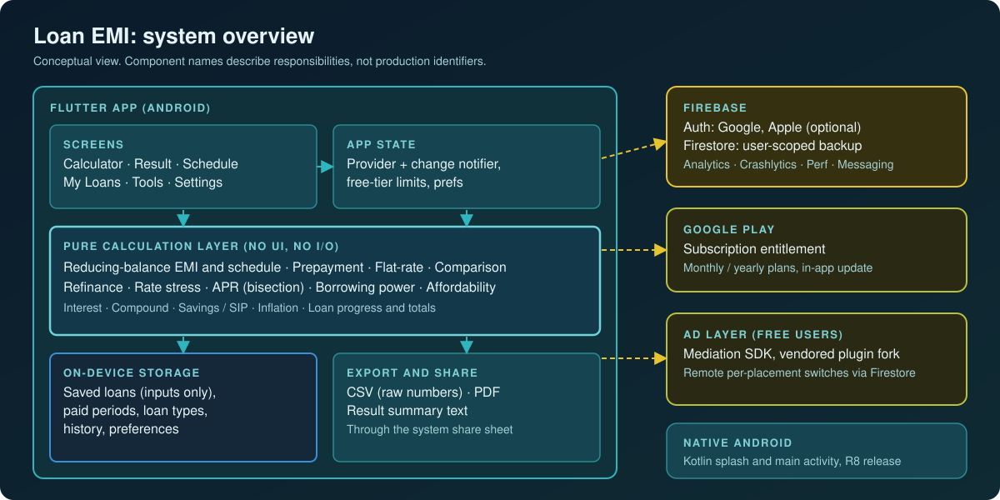

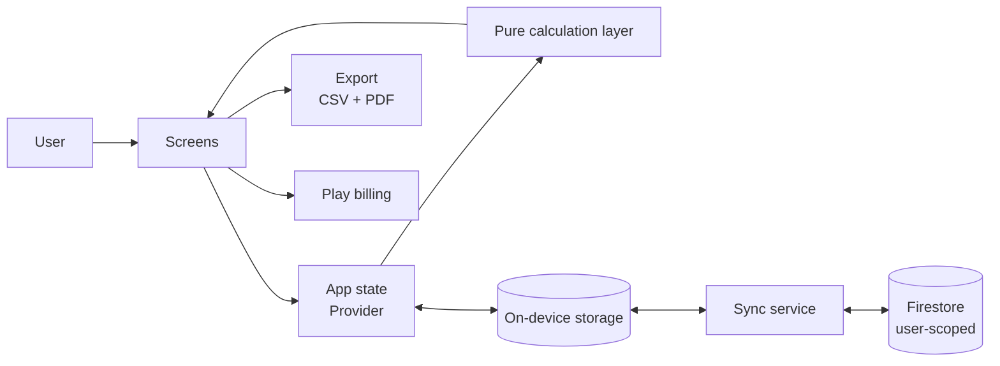

Details: [docs/ARCHITECTURE.md](docs/ARCHITECTURE.md).

## Technology Stack

| Layer | Technology |
|---|---|
| App | Flutter / Dart 3, `provider` |
| Local data | `shared_preferences` with per-record JSON |
| Cloud | Firebase Auth, Firestore, Messaging, Analytics, Crashlytics, Performance |
| Sign-in | Google and Apple |
| Export | `pdf`, `share_plus`, generated CSV |
| Billing | `in_app_purchase` with Android subscription types; Play in-app update |
| Ads | Mediation SDK through a vendored plugin fork with a preload cache |
| Notifications | `flutter_local_notifications`, timezone-aware scheduling |
| Charts | Custom painters (no charting library) |
| Localisation | ARB files with generated `AppLocalizations`, bundled Noto fonts for Arabic, Urdu and Devanagari |
| Native | Kotlin splash activity and main activity |
| Tooling | R8 minification and resource shrinking in release |

## Documentation

| Read | For |
|---|---|
| [Technical case study](docs/TECHNICAL_CASE_STUDY.md) | End-to-end write-up, including the EMI maths |
| [Architecture](docs/ARCHITECTURE.md) | Layers, flows and diagrams |
| [Engineering challenges](docs/ENGINEERING_CHALLENGES.md) | Problem, context, approach, trade-offs, outcome |
| [Product overview](docs/PRODUCT_OVERVIEW.md) | Features, screens and flows |
| [Privacy and source](docs/PRIVACY_AND_SOURCE.md) | What is and is not published |

## Source Code

This repository is a portfolio showcase for a production application. Production source code is maintained privately. See [RIGHTS.md](RIGHTS.md) for usage terms.
