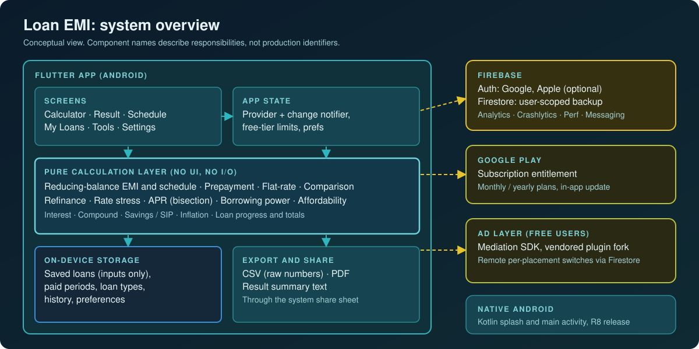
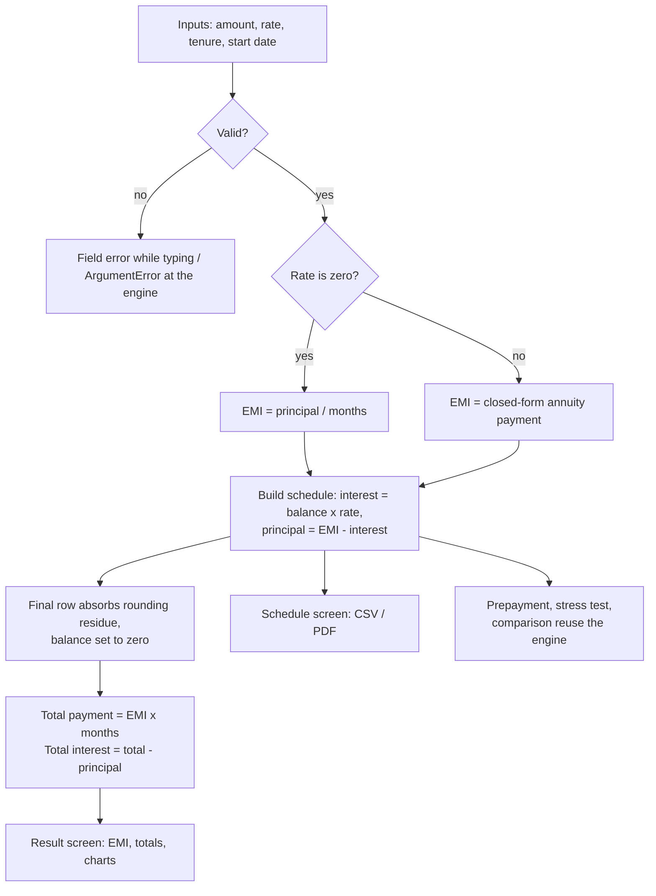
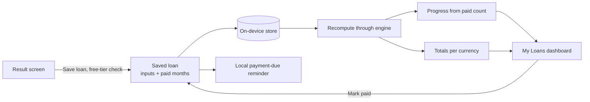
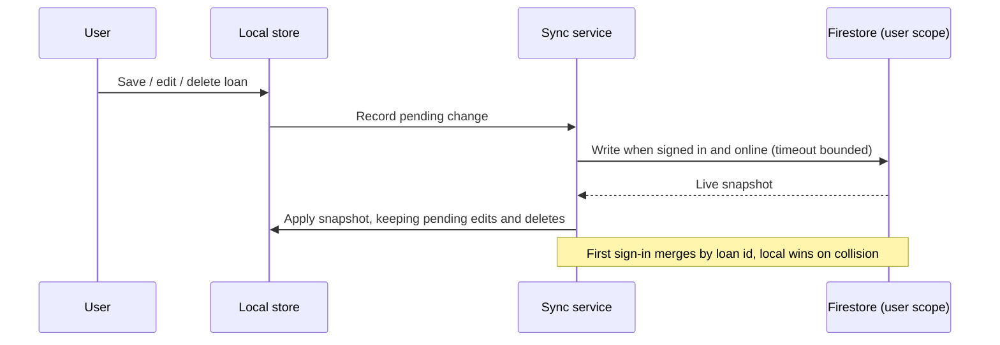
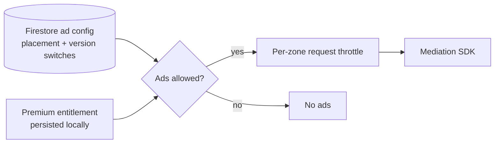

# Architecture

A single Flutter app with a deliberately thin boundary: pure calculation code at the centre, on-device storage around it, and optional services (Firebase, Play billing, ads) layered on the edges. Component names here are conceptual.

## Layers

| Layer | Responsibility |
|---|---|
| Screens | Calculator, Result, Schedule, My Loans, Tools hub and each tool, Settings, onboarding, paywall |
| App state | One change-notifier model exposed through `provider`: language, currency, theme, income, saved loans, free-tier counters, current tab |
| Calculation layer | A set of small files of pure Dart with no UI, storage or network: EMI engine, prepayment, comparison, flat rate, refinance, stress test, APR, borrowing power, affordability, interest, savings, inflation, loan progress and totals |
| Persistence | `shared_preferences`; saved loans stored one JSON record each, with a fail-safe wrapper that falls back to defaults |
| Sync | Optional Firestore mirror for signed-in users |
| Services | Billing, ads, analytics, notifications, in-app update, connectivity |
| Native | Kotlin splash activity and main activity |

State is held by one `AppState` change notifier plus a purchase service, supplied through `MultiProvider` with Firebase access as a plain provider.

## System overview

  

## Calculation flow

## Saved loan lifecycle

## Sync flow

## Ads and entitlement

Remote config fails open: if it cannot be read, every placement stays enabled. Premium removes ads everywhere through one central gate.

## Startup

`main` loads preferences before the first frame so routing is correct on a cold start, records the first-launch time, loads saved loans and loan types, re-syncs payment reminders (to recover any the OS evicted), and brings up Firebase and the ad SDK on a best-effort basis. Firebase and ad failures degrade the feature and never block launch. A native Kotlin splash activity mirrors the first Flutter splash frame and hands off to the main activity without an animation.

## Design choices

- **Pure core.** Maths lives outside widgets so it can be tested without a widget tree.
- **Derived over stored.** Saved loans keep inputs; everything displayed is recomputed.
- **Hand-drawn charts.** The pie and balance-over-time charts are custom painters, so there is no charting dependency.
- **Single source of limits.** Free-tier numbers are defined in one class.
